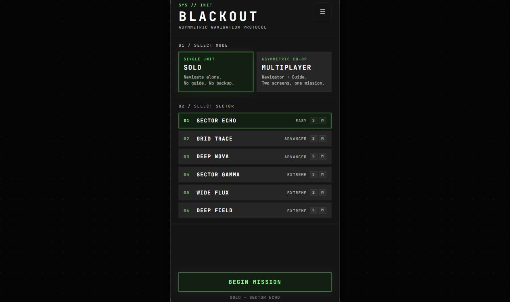
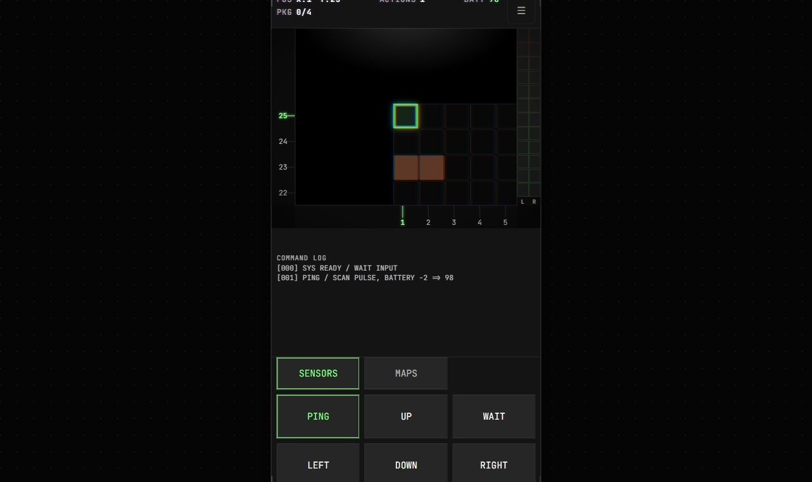

# Building Blackout: A Cooperative Game with Two Different Views

## Play Blackout

[Open the live browser game](https://blackout-ten.vercel.app/)

The deployed game offers solo play and asymmetric multiplayer. In multiplayer, one person navigates while the other guides from a separate screen.

### Screenshots from the live game

*Mode and sector selection in the live browser game.*

*Sector Echo in solo mode after a sensor ping.*

## Project Summary

I developed a game called Blackout, with AI helping me work on the code and visual design.

It was a cooperative maze game for two people on separate devices. One player controlled the character with limited visibility. The other had a map view and had to talk them through the level. One person had the controls, the other had information they needed, and the two had to coordinate.

The game included hazards, moving enemies, items to collect, and gates that changed with the turn cycle. That meant developing both the game mechanics and the way those changes appear on the other player's screen.

I also built a world editor so I could create levels and test them directly inside the editor. There were controls for restarting a test, revealing the map, and using god mode while checking a layout. I could make a change and try it without going through the normal game setup each time.

As the project grew, I worked through refactoring the code, reorganizing the visual effects, and fixing movement and collision behavior. I used AI to help redesign the blocks and game entities and explore different visual themes.

The multiplayer side brought its own work: joining a session, keeping the guide's view synchronized, and detecting when a connection drops. A phone going to sleep or returning to the browser became part of the development process too.

## Overview

I developed Blackout as a browser game built around asymmetric cooperation. Two people played on separate devices with different views of the same level. The player moving through the maze had limited visibility, while the guide had a map view and gave verbal directions.

The project grew from that interaction into a larger development effort involving movement, hazards, enemies, level creation, visual effects, and multiplayer session handling. I used AI during development to work on the code, redesign game elements, and explore visual themes.

## Role

I developed the game around the player and guide relationship, directed its mechanics and visual direction, and worked through the implementation with AI assistance.

My work included creating and revising levels, building tools to test them, adjusting the presentation, and investigating how the game behaved across two devices. The development notes also document returning to the project after periods away and continuing through several rounds of refactoring.

## Scope Of Work

The application included the game view, a separate guide interface, multiplayer lobby and session controls, a world editor, a level registry, and supporting systems for movement, enemies, visibility, effects, and sound.

The implementation used HTML, CSS, and JavaScript, with PeerJS for the multiplayer connection layer. The player and guide interfaces shared information about the same session while presenting it differently.

## Key Actions

- Developed the limited visibility player view and separate guide map.
- Added hazards, collectible items, enemy behavior, and gates tied to a turn cycle.
- Built a world editor with integrated playtesting and debugging controls.
- Worked on randomized level starting points and reusable level data.
- Refactored gameplay responsibilities into more focused systems.
- Reorganized visual effects and developed alternative themes with AI assistance.
- Added multiplayer synchronization, heartbeat monitoring, and reconnect handling.
- Moved level definitions from JavaScript into JSON and updated progression across solo and multiplayer modes.

## Important Features

### Different information on each device

The central mechanic depended on the two players having different roles. The person navigating the maze acted on information supplied by the guide, who watched the map from another device.

That distinction carried into the software. There was a dedicated guide view, a host game view, and a multiplayer layer that passed session information between them. The guide interface tracked information such as the player's position, collected items, and the state of the level.

Verbal guidance was part of the game concept; the software provided the separate views and shared state.

### Movement, enemies, and changing hazards

The game used a grid with defined entity types, including walls, hazards, charge items, packages, exits, and enemy actors. The implementation distinguished how entities blocked movement, appeared on the map, and responded to visibility mechanics.

The development history records work on sentry and tracker enemies, collision behavior, and automatic gates. The gates changed state with the turn cycle, so the guide needed information that agreed with the player's current turn.

A separate turn resolver handled movement intent and actor interactions. This gave the rules for moving through the level a defined place in the code as the mechanics became more involved.

### Building the tools to build levels

I added playtesting directly inside the world editor. The editor could launch a test session and provide controls for restarting, revealing the map, and toggling god mode.

The test interface also reported gameplay state, including position, battery, and collected packages. That made it possible to examine a layout while keeping the editing tools close at hand.

The editor included import and export functions and tools for generating level starting points. The development notes describe this as a substantial improvement in the level creation workflow.

### Level data and progression

The repository history records a move from JavaScript level definitions to JSON files. A level registry normalized the definitions, ordered levels, and resolved them for the game.

The registry also included compatibility behavior that preferred JSON when a legacy JavaScript definition shared the same identifier. This allowed the data format to change while retaining a defined way to resolve older content.

Related development work updated level completion and progression for both solo and multiplayer play.

## How I Used AI During Development

### Working from the existing application

I used AI throughout the development process to help implement changes, review the code, and explore different ways to organize the application.

As the project grew, I could bring the existing code into an AI session and work on a specific part of it. My development notes recorded using Gemini for refactoring and using its web interface as another way to get feedback on the project alongside my work in Cursor.

That gave the discussion a concrete starting point: the application, its current behavior, and the change I wanted to make.

### Exploring visual alternatives

One specific example was the visual design. Because the game elements were built with HTML and CSS, I uploaded the existing game to Gemini and asked it to create 12 new themes for the blocks and entities.

This let me explore different treatments of the same game elements using the existing implementation as context. The work covered the visual presentation of the game itself, alongside the separate effort to organize effects such as scan lines, vignette, and chromatic aberration.

### Connecting code changes to playtesting

The development cycle involved working on a change with AI, trying it in the game, identifying what needed adjustment, and continuing from that result.

Adding playtesting inside the world editor made that cycle easier to repeat. I could create or modify a layout, run it, inspect the behavior, and return to editing. God mode let me examine a level without a death ending the test.

The notes from that period captured specific problems to work through, including the player and an enemy passing through each other during discrete movement, map information appearing when it should have remained hidden, and visual effects consuming too many resources.

### Developing the supporting tools

AI-assisted work extended into the tools around the game: the editor, level handling, visual systems, and code organization.

The editor and random level generator gave me a starting point I could reshape and test. Refactoring helped separate responsibilities as the game accumulated more mechanics. The process combined deciding how the game should behave with implementing, observing, and adjusting that behavior.

## Development Pipeline

### Establishing the interaction

The starting point was the two-player concept: one person moves with limited visibility and the other guides them. The subsequent work added the mechanics and interfaces needed to make that interaction playable.

### Expanding the gameplay and visual direction

As the game developed, I added enemy behavior, worked on collisions, and expanded the visual presentation. My notes record using AI to redesign blocks and entities and generate alternative themes.

The effects included scan lines, vignette treatments, and chromatic aberration. I also worked on consolidating the effects because combinations of them were affecting performance. The development involved adjusting both their appearance and how they were applied.

### Refactoring the growing application

The repository contains an architecture audit and refactoring notes covering responsibilities that had accumulated in the main game script. The later source includes separate systems for movement, camera behavior, ping behavior, cell reveals, level control, and shared services.

This was an ongoing part of development as new mechanics were added. The retained notes still identify areas for further cleanup, so the refactor is best described as progressive work rather than a completed rewrite.

### Synchronizing the two views

The multiplayer code passed session messages, position updates, actor state, and turn information between the host and guide. The commit history specifically records work to synchronize the second player's display with the first player's turn clock.

The code also accounted for level completion, session state, and the information needed to restore the guide's view after reconnecting.

### Handling connection interruptions

Testing the two-device interaction raised questions about what happens when a phone becomes inactive or returns to the browser.

The implementation included heartbeat messages, connection timing, session information, and bounded reconnect attempts. The multiplayer debug log records work on signaling connections, initial connection timeouts, reconnect behavior, and ignoring events from an obsolete connection.

The recovery mechanisms were part of the implementation; broader device and network testing remained a separate part of development.

## Constraints And Decisions

The mobile focus influenced the interface, effects, and connection handling. A visually busy effect stack had to be considered alongside responsiveness, and a multiplayer session had to account for devices losing focus or connectivity.

The editor and test controls supported iteration on the mechanics. Keeping level definitions in data files also gave the game a clearer separation between its content and its runtime code.

I retained the central asymmetric interaction while continuing to work on the systems around it.

## Deliverables

- A browser game with distinct player and guide interfaces.
- Multiplayer lobby, session, and synchronization code.
- Grid movement, hazards, enemies, collectible items, and turn-dependent gates.
- A world editor with integrated playtesting and debugging controls.
- JSON level definitions, a level registry, and progression handling.
- Visual themes, effects systems, and development documentation.
- Connection monitoring and reconnect logic.

## Outcome

Blackout developed into a game project with its own level creation and testing tools, alongside the cooperative gameplay.

The development record shows repeated work on the editor, mechanics, presentation, architecture, and multiplayer behavior. AI assisted with implementation and visual exploration while I continued shaping the game and testing how its pieces worked together.

## Tools And Methods

HTML, CSS, JavaScript, PeerJS, GitHub version history, JSON level data, a browser-based world editor, integrated playtesting, code review, and AI-assisted development.

The implementation used separate modules for gameplay systems, entity definitions, presentation, and multiplayer handling. Repository comments, commit messages, project notes, and the multiplayer debug log preserve the reasoning and changes made during development.

## Evidence And Limitations

This article is a retrospective on the development work, based on the retained source, GitHub repository, commit history, and project notes. The records reviewed do not establish a commercial release.

The public Vercel deployment was checked on November 26, 2026. The mode and sector selection screen loaded, Sector Echo opened in solo mode, and a sensor ping updated the action count, battery status, and command log. The screenshots above were captured from that deployment. Two-device multiplayer, performance under load, and reconnect behavior were not retested in this check.
